  

JURNAL COSMIC &nbsp; / &nbsp; EXPERIMENT WEB 01

<h1 align="center">L5 — Salut, Univers!</h1>

<strong>O pagină mică. Un început mare.</strong>

  <a href="#despre">01 · Despre</a> &nbsp; / &nbsp;
  <a href="#exploreaza">02 · Explorează</a> &nbsp; / &nbsp;
  <a href="#structura">03 · Structură</a>

---

## Despre

L5 este un exercițiu introductiv de web development, realizat în HTML. Pagina întâmpină vizitatorii cu un mesaj de bun venit, iar această prezentare îi dă proiectului propriul mic univers.

## Explorează

  

Treci cu cursorul peste stele și planetă pentru a le aprinde. Linkurile de mai sus te duc direct la fiecare secțiune.

## Rulare

Deschide `index.html` într-un browser pentru a vedea pagina web.

## Structură

- `index.html` — pagina web introductivă
- `cosmic-banner.svg` — ilustrația principală animată
- `orbit-details.svg` — constelația interactivă din această prezentare

L5 &nbsp; · &nbsp; UN UNIVERS ÎN CONSTRUCȚIE

