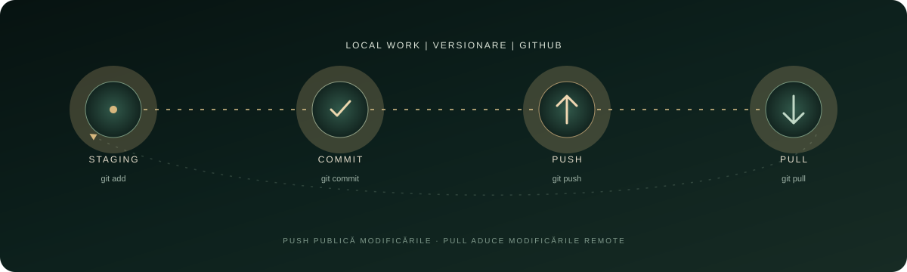

<p align="center">
  
</p>

<p align="center"><sub>LABORATORUL 05 &nbsp; / &nbsp; MANAGEMENTUL CODULUI</sub></p>

<h1 align="center">Git · GitHub · VS Code</h1>

<p align="center"><strong>De la prima modificare locală la un proiect sincronizat online.</strong></p>

<p align="center">
  <a href="#obiectiv">01 Obiectiv</a> &nbsp; / &nbsp;
  <a href="#flux-git">02 Flux Git</a> &nbsp; / &nbsp;
  <a href="#resurse">03 Resurse</a>
</p>

---

## Obiectiv

Laboratorul prezintă gestionarea codului sursă cu Git, găzduirea proiectelor pe GitHub și integrarea fluxului de lucru în Visual Studio Code. Scopul este să exersezi versionarea, sincronizarea și organizarea modificărilor într-un repository.

### Competențe urmărite

- Înțelegerea rolului unui sistem de control al versiunilor și a unui repository.
- Inițializarea unui repository local și verificarea stării fișierelor.
- Pregătirea modificărilor în staging și salvarea lor prin commit-uri descriptive.
- Folosirea branch-urilor pentru linii de dezvoltare separate.
- Conectarea repository-ului local la un remote GitHub.
- Sincronizarea modificărilor cu `push` și `pull` din terminal sau VS Code.
- Documentarea proiectului în Markdown prin `README.md`.

## Flux Git

<p align="center">
  
</p>

Treci cu cursorul peste etapele diagramei pentru efectul de lumină. Apasă pe titlurile de mai jos pentru exemple de comenzi.

<details>
<summary><strong>01 · Pregătește și salvează modificările</strong></summary>

```bash
git status
git add README.md
git commit -m "Descrie pe scurt modificarea"
```

`git status` arată starea fișierelor, `git add` le pregătește pentru commit, iar `git commit` salvează o versiune în istoricul local.

</details>

<details>
<summary><strong>02 · Lucrează pe un branch separat</strong></summary>

```bash
git switch -c feature/nume-scurt
git branch
git switch main
```

Un branch oferă o linie separată de lucru. `HEAD` indică poziția curentă în istoricul repository-ului.

</details>

<details>
<summary><strong>03 · Sincronizează cu GitHub</strong></summary>

```bash
git remote -v
git push
git pull
```

Remote-ul leagă copia locală de repository-ul găzduit. `push` trimite commit-urile locale, iar `pull` aduce și integrează schimbările de pe server.

</details>

## Markdown în practică

README-ul este scris în Markdown, cu titluri, liste, linkuri, imagini și secțiuni expandabile. Pentru proiecte, documentația ar trebui să explice scopul, modul de rulare și structura fișierelor.

<p align="center">
  
</p>

## Structura proiectului

- `index.html` — pagina web introductivă
- `README.md` — prezentarea laboratorului și notițele de lucru
- `cosmic-banner.svg` — bannerul animat
- `git-workflow.svg` — diagrama interactivă staging–commit–push–pull
- `orbit-details.svg` — ilustrație interactivă suplimentară

## Resurse

- [Documentația oficială Git](https://git-scm.com/docs)
- [Markdown Live Preview](https://markdownlivepreview.com)
- [Exemple de README-uri GitHub](https://github.com/abhisheknaiidu/awesome-github-profile-readme)

<p align="center"><sub>L5 &nbsp; · &nbsp; VERSIONARE, COLABORARE, DOCUMENTARE</sub></p>
